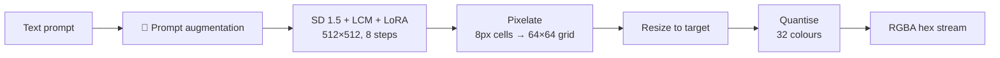

<p align="center">
  
  
  
  
  
</p>

<h1 align="center">SpriteStack PixelGen</h1>

<p align="center">
  <strong>Text-to-pixel-art sprite generation pipeline for <a href="https://github.com/Azjob21/spritestack">SpriteStack Studio</a></strong>
</p>

<p align="center">
  
  
  
  
</p>

<p align="center">
  Type a prompt → get a pixel-art sprite in seconds.<br>
  Built for game dev. Integrated into SpriteStack Studio.
</p>

---

## Sample Gallery(show off hhh)

All sprites below were generated with the v0 pipeline — **no cherry-picking**, just one prompt, one seed, one output.

<table>
  <tr>
    <td align="center"><br><sub><b>Knight</b></sub><br><sub><code>"knight with silver armor and sword"</code></sub><br><sub>seed 7 · 64×64 · 125s</sub></td>
    <td align="center"><br><sub><b>Dragon</b></sub><br><sub><code>"red dragon breathing fire"</code></sub><br><sub>seed 13 · 64×64 · 116s</sub></td>
    <td align="center"><br><sub><b>Wizard</b></sub><br><sub><code>"wizard casting magic spell with staff"</code></sub><br><sub>seed 21 · 64×64 · 121s</sub></td>
    <td align="center"><br><sub><b>Treasure</b></sub><br><sub><code>"golden treasure chest with gems"</code></sub><br><sub>seed 5 · 64×64 · 117s</sub></td>
    <td align="center"><br><sub><b>Skeleton</b></sub><br><sub><code>"skeleton warrior with bone sword"</code></sub><br><sub>seed 33 · 64×64 · 116s</sub></td>
  </tr>
</table>

> **Hardware:** Intel Core i7-1065G7 (CPU-only, fp32) · ~116s per sprite · 8 LCM steps at 512×512 → pixelated to 64×64

---

## What this is (and is not)

v0 **composes existing open models** — it does not train a new one.

The original work is the **pipeline**: prompt design, LCM fast sampling, LoRA fusing, pixel-grid post-processing, palette reduction, and Studio integration.

| Component       | Used in v0                                                   | Source                                    |
| --------------- | ------------------------------------------------------------ | ----------------------------------------- |
| Base model      | Stable Diffusion 1.5, DreamShaper 8 LCM                      | `Lykon/dreamshaper-8-lcm`                 |
| Style LoRA      | PixelArt Redmond (SD 1.5), fused at scale 0.9                | see its model card for author and licence |
| Scheduler       | `LCMScheduler`, 8 steps, guidance 1.8                        | diffusers                                 |
| Post-processing | Nearest-neighbour pixelation, resize, 32-colour quantisation | this repo                                 |

Model weights are **not** distributed here. Check each model's licence before redistributing.

---

## Pipeline



**API Contract** (`POST /generate-sprite`)

```json
// Request
{ "prompt": "small slime enemy", "width": 32, "height": 32 }

// Response
{ "hex": "RRGGBBAA...", "width": 32, "height": 32, "prompt": "...", "model": "..." }
```

---

## Benchmarks

> v0 baseline on Intel Core i7-1065G7 (CPU-only, fp32, 8 steps, guidance 1.8)

| ID     | Change                                    | CPU latency   | Quality notes                                      |
| ------ | ----------------------------------------- | ------------- | -------------------------------------------------- |
| **v0** | **Baseline**                              | **~116–125s** | Solid pixel-art style, no transparency, fixed seed |
| e1     | Trigger word (`PixArFK`) + prompt cleanup | TBD           | TBD                                                |
| e2     | Guidance 1.0 (CFG off)                    | TBD           | Expected ~50% speedup                              |
| e3     | 4 steps                                   | TBD           | Expected ~50% speedup                              |
| e4     | Grid snapping + palette presets           | TBD           | TBD                                                |
| e5     | Background removal                        | TBD           | TBD                                                |
| e6     | OpenVINO / ONNX export                    | TBD           | Expected major CPU speedup                         |

**Target:** Bring generation under **10 seconds** on CPU through combined optimizations.

---

## Known Limitations (v0)

| #   | Issue                                                            | Impact                             |
| --- | ---------------------------------------------------------------- | ---------------------------------- |
| 1   | **No transparency** — SD outputs RGB, alpha is always 255        | Background baked into sprite       |
| 2   | **Grid decimation** — naive resize skips cells for small targets | Detail loss at 16×16, 32×32        |
| 3   | **Fixed seed (42)** — same prompt = same image                   | No variation/re-roll               |
| 4   | **CFG on** (guidance 1.8 + negative prompt)                      | Doubles UNet work per step         |
| 5   | **Missing trigger word** — `PixArFK` not in prompt               | LoRA may not fully activate        |
| 6   | **Generic palette** — no DB32/PICO-8/Endesga 32                  | Colours don't match Studio presets |

---

## Roadmap

<table>
  <tr>
    <td>

**Phase 0: Baseline**

- [x] Extract pipeline to standalone package
- [x] 30-prompt evaluation set
- [ ] Full benchmark sweep on named hardware
- [ ] Save v0 sample grids to `eval/v0/`

</td>
    <td>

**Phase 1: Quality**

- [ ] LoRA trigger word + prompt cleanup
- [ ] Proper grid snapping (dominant colour per cell)
- [ ] Palette-constrained quantisation
- [ ] Background removal (hard 0/255 alpha)
- [ ] Seed control + batch candidates

</td>
  </tr>
  <tr>
    <td>

**Phase 2: Speed**

- [ ] Step count sweep (8 → 6 → 4)
- [ ] CFG off (guidance 1.0)
- [ ] Resolution sweep (512 → 384)
- [ ] Tiny VAE (TAESD)
- [ ] OpenVINO / ONNX (CPU path)
- [ ] `torch.compile` + `channels_last`

</td>
    <td>

**Phase 3: Model & Release**

- [ ] LoRA scale sweep
- [ ] Alternative LoRAs (LCM-LoRA, Hyper-SD)
- [ ] Train custom pixel-art LoRA
- [ ] Hugging Face Space demo
- [ ] Weights on HF Hub

</td>
  </tr>
</table>

---

## Quick Start

```bash
# Install
pip install -e ".[dev]"

# Generate a sprite
python -m pixelgen.cli generate "knight with silver armor" --size 64x64 --out knight.png

# Run the full benchmark (30 prompts)
python -m pixelgen.cli benchmark --prompts benchmarks/prompts.txt --out eval/v0/

# Start the Studio-compatible API server
pip install -e ".[server]"
python -m pixelgen.server --port 8000
```

> **Note:** Place model weights under `models/pixel-art-model/` and `models/loras/` before running. See [models/.gitkeep](models/.gitkeep) for details.

---

## Repo Layout

```
spritestack-pixelgen/
├── src/pixelgen/
│   ├── pipeline.py         # v0 frozen baseline (tagged ISSUE(v0) comments)
│   ├── postprocess.py      # pixelation, resize, quantisation
│   ├── palettes.py         # DB32, PICO-8, Endesga 32 palette data
│   ├── encode.py           # fast RGBA ↔ hex encoding
│   ├── cli.py              # generate + benchmark commands
│   └── server.py           # FastAPI drop-in for Studio
├── benchmarks/prompts.txt  # 30 evaluation prompts
├── docs/samples/           # generated sprite gallery
├── eval/                   # benchmark outputs per experiment
├── tests/                  # unit tests (6 passing )
└── models/                 # weights (gitignored)
```

---

## Evaluation Metrics

| Metric                  | What it measures                               |
| ----------------------- | ---------------------------------------------- |
| **Latency p50 / p95**   | Generation speed                               |
| **Peak memory**         | RAM/VRAM footprint                             |
| **Unique colour count** | Palette discipline                             |
| **Grid cleanliness**    | Fraction of uniform cells after grid detection |
| **Transparency rate**   | Outputs with clean background cut              |
| **CLIP score**          | Prompt–image alignment                         |
| **Blind A/B pref**      | Human judgement on fixed prompt set            |

---

## Credits

- **Base model:** DreamShaper 8 LCM (see its [model card](https://huggingface.co/Lykon/dreamshaper-8-lcm))
- **Style LoRA:** PixelArt Redmond for SD 1.5 (see its model card)
- **Libraries:** Hugging Face `diffusers`, PyTorch, Pillow
- **Project:** Part of [SpriteStack Studio](https://github.com/Azjob21/spritestack) (supervised by Prof. Chaib Souleyman)

## License

Code: **MIT**. Model weights keep their original licences.
