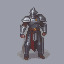
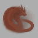
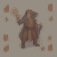
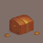
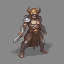

<p align="center">
  
  
  
  
  
</p>

<h1 align="center">SpriteStack PixelGen</h1>

<p align="center">
  <strong>Text-to-pixel-art sprite generation pipeline for <a href="https://github.com/Azjob21/spritestack">SpriteStack Studio</a></strong>
</p>

<p align="center">
  
  
  
  
</p>

<p align="center">
  Type a prompt → get a transparent pixel-art sprite, on CPU, with no GPU required.<br>
  A showcase project for SpriteStack Studio.
</p>

---

## Sample Gallery

All sprites below were generated with the **v0** pipeline (the original baseline) — no cherry-picking, just one prompt, one seed, one output. The current default (`s6`) uses faster sampling and the newer post-processing described below, so its output differs.

<table>
  <tr>
    <td align="center"><br><sub><b>Knight</b></sub><br><sub><code>"knight with silver armor and sword"</code></sub><br><sub>seed 7 · 64×64 · 125s</sub></td>
    <td align="center"><br><sub><b>Dragon</b></sub><br><sub><code>"red dragon breathing fire"</code></sub><br><sub>seed 13 · 64×64 · 116s</sub></td>
    <td align="center"><br><sub><b>Wizard</b></sub><br><sub><code>"wizard casting magic spell with staff"</code></sub><br><sub>seed 21 · 64×64 · 121s</sub></td>
    <td align="center"><br><sub><b>Treasure</b></sub><br><sub><code>"golden treasure chest with gems"</code></sub><br><sub>seed 5 · 64×64 · 117s</sub></td>
    <td align="center"><br><sub><b>Skeleton</b></sub><br><sub><code>"skeleton warrior with bone sword"</code></sub><br><sub>seed 33 · 64×64 · 116s</sub></td>
  </tr>
</table>

> **Hardware:** Intel Core i7-1065G7 (4 cores, CPU-only, fp32). The times above were measured in the first runs and include cold-start overhead. Steady-state v0 is about 96s per sprite (see [Benchmarks](#benchmarks)).

---

## What this is (and is not)

PixelGen **composes existing open models** — it does not train a new one.

The original work is the **pipeline**: prompt design, LCM fast sampling, LoRA fusing, background keying, pixel-grid snapping, palette reduction, sprite cleanup, an OpenVINO CPU path, and Studio integration.

| Component       | Used                                                                                                  | Source                                                  |
| --------------- | ----------------------------------------------------------------------------------------------------- | ------------------------------------------------------- |
| Base model      | Stable Diffusion 1.5, DreamShaper 8 LCM                                                               | `Lykon/dreamshaper-8-lcm`                               |
| Style LoRA      | PixelArt Redmond 1.5V (SD 1.5), fused at scale 0.9                                                    | `artificialguybr/pixelartredmond-1-5v-pixel-art-loras-for-sd-1-5` |
| Scheduler       | `LCMScheduler`, 6 steps, guidance 2.5 (default `s6`)                                                  | diffusers                                               |
| Decoder         | TAESD (tiny VAE)                                                                                      | `madebyollin/taesd`                                     |
| Post-processing | Background keying, median-per-cell grid snapping, palette snapping, cleanup, optional outline         | this repo                                               |
| CPU runtime     | PyTorch (default) or OpenVINO fp32 / int8 via `optimum-intel` (benchmark script)                      | `optimum-intel`                                         |

Model weights are **not** distributed here. See [Licences](#licences) before redistributing.

---

## Pipeline


**API Contract** (`POST /generate-sprite`)

```json
// Request (only prompt is typically needed)
{ "prompt": "small slime enemy", "width": 32, "height": 32,
  "seed": 123, "palette": "db32", "variant": "s6" }

// Response
{ "hex": "RRGGBBAA...", "width": 32, "height": 32, "prompt": "...",
  "model": "spritestack-pixelgen-s6", "seed": 123, "variant": "s6",
  "palette": "db32", "timings": { "unet_s": 0, "decode_s": 0, "post_s": 0, "total_s": 0 } }
```

`seed`, `palette` and `variant` are optional. The server's default variant comes from `PIXELGEN_VARIANT` (default `s6`).

---

## Benchmarks

Measured on an Intel Core i7-1065G7 (CPU-only, fp32), 64×64 output, seed 42, steady-state p50 after a warm-up generation. Run-to-run noise is about ±25%, so use the Best performance power plan and plug in the laptop. Each row is **3 prompts** (red dragon, wizard casting spell, skeleton warrior) with a single seed, so quality notes are one-sample judgements.

| Config                                         | UNet  | Decode | p50    | Verdict                                              |
| ---------------------------------------------- | ----- | ------ | ------ | ---------------------------------------------------- |
| **v0** (8 steps, guidance 1.8)                 | 84s   | 13s    | 96s    | Crisp reference (about 115s on a cold start)         |
| Magenta-backdrop prompt (`e2`)                 | 85s   | 13s    | 96s    | Subjects tinted and wrong — abandoned                |
| CFG off (guidance 1.0, `g3`)                   | 46s   | 13s    | 59s    | Style destroyed                                      |
| 4 steps (`s4`)                                 | 43s   | 13s    | 56s    | Style holds, loses coherence on complex subjects     |
| 4 steps + TAESD                                | 42s   | 0.9s   | 43s    | TAESD is visually lossless in practice               |
| 4 steps + TAESD + guidance 2.5                 | 41s   | 0.9s   | 41.6s  | Sharper, weak on complex subjects                    |
| 384px generation                               | 26s   | 0.7s   | 27.5s  | Dragon collapses                                     |
| 448px generation                               | 36s   | 0.9s   | 37s    | Only about 13% faster, no gain                       |
| 5 steps + TAESD + guidance 2.5                 | 50s   | 0.8s   | 50.4s  | Wings return, smudgy                                 |
| **6 steps + TAESD + guidance 2.5 (`s6`)**      | 71s   | 1.0s   | 73.8s  | **Recommended default** — dragon and wizard readable |
| 8 steps + TAESD + guidance 2.5                 | 91s   | 0.9s   | 93s    | Best quality, no faster than v0                      |
| `s6` on OpenVINO fp32                          | 60.5s | 1.2s   | 60.7s  | Steadier timings (60.2–64.4s)                        |
| `s6` on OpenVINO int8 (weight compression)     | 50.7s | 1.3s   | 52.3s  | Quality looked equal on 3 sprites                    |

Findings:

- The UNet is about 86% of the total time; the VAE decode is about 14% without TAESD, and post-processing is negligible (about 0.1s).
- Below 512px the model collapses, so generation stays at 512×512.
- Guidance 2.5 makes backdrops gradient or vignetted; the edge-bounded keying handles that.
- OpenVINO int8 gave about 14% over fp32 and about 30% over PyTorch at 6 steps.

**Target:** under **10 seconds** on CPU. **Not reached.** The best measured result is about 52s (OpenVINO int8, 6 steps). The remaining cost is the number of UNet passes (6 steps at guidance 2.5 is 12 passes at 512×512). Getting to about 10s would need a different model class (for example a small model trained for low resolution) or a GPU. Few-step distilled models such as Hyper-SD have not been tested.

---

## Known Limitations

| #   | Issue                                                                                                           | Status                                  |
| --- | --------------------------------------------------------------------------------------------------------------- | --------------------------------------- |
| 1   | **Default seed is fixed (42)** — same prompt gives the same image unless `--seed` / `seed` is passed             | Pass a seed for variation               |
| 2   | **Warm-toned ground rims** — a brown rim can remain around feet (for example the wizard) or a dragon's underside | Open; neutral-grey cleanup misses it    |
| 3   | **Skeleton prompt** produces an armoured warrior, not a skeleton                                                | Open; prompt problem, not a step-count one |
| 4   | **Stray scene objects** can appear in raw output; the cleanup drops small detached ones                          | Reduced, not eliminated                 |
| 5   | **Low-contrast grey-on-grey objects** (for example rocks near a slime) can be eaten by the grey cleanup          | Tune `grey_chroma` or set it to 0       |
| 6   | **One seed per prompt** in all benchmarks                                                                        | Needs multi-seed evaluation             |
| 7   | **Not 10s** — see [Benchmarks](#benchmarks)                                                                      | Open                                    |

Fixed since v0: transparency (hard 0/255 alpha via background keying), grid decimation (median-per-cell snapping), palette presets (DB32, PICO-8, Endesga 32), and a tiny-VAE decoder.

---

## Roadmap

<table>
  <tr>
    <td>

**Phase 0: Baseline**

- [x] Extract pipeline to standalone package
- [x] 30-prompt evaluation set
- [ ] Full benchmark sweep on all 30 prompts (so far: 3 hard prompts)
- [ ] Save v0 sample grids to `eval/v0/`

</td>
    <td>

**Phase 1: Quality**

- [x] Prompt experiments (magenta-backdrop ladder tried and dropped)
- [x] Grid snapping (median colour per cell)
- [x] Palette-constrained quantisation
- [x] Background removal (hard 0/255 alpha)
- [x] Seed control
- [ ] Batch candidates
- [ ] Better prompts (single subject, no ground, plain background)
- [ ] Warm-toned shadow / ground-rim cleanup

</td>
  </tr>
  <tr>
    <td>

**Phase 2: Speed**

- [x] Step count sweep (8 → 6 → 5 → 4)
- [x] CFG off (rejected: style collapses)
- [x] Resolution sweep (rejected: below 512 collapses)
- [x] Tiny VAE (TAESD)
- [x] OpenVINO fp32 and int8 (benchmark script)
- [x] `channels_last`
- [ ] OpenVINO backend in the server
- [ ] `torch.compile`

</td>
    <td>

**Phase 3: Model & Release**

- [ ] LoRA scale sweep
- [ ] Few-step distilled alternatives (for example Hyper-SD — untested)
- [ ] Small low-resolution model for a 10s CPU path
- [ ] Train custom pixel-art LoRA
- [ ] Hugging Face Space demo
- [ ] Weights on HF Hub

</td>
  </tr>
</table>

---

## Quick Start

```bash
# Install
pip install -e ".[dev]"

# Generate a sprite (default variant: s6)
python -m pixelgen generate "knight with silver armor" --size 64x64 --seed 7 --out knight.png

# Run a benchmark (writes timings.csv, summary.txt, sheet.png)
python -m pixelgen benchmark --prompts benchmarks/hard3.txt --save-raw --out eval/

# Override any setting for an ablation
python -m pixelgen benchmark --variant s6 --steps 8 --prompts benchmarks/hard3.txt --out eval/

# Start the Studio-compatible API server
pip install -e ".[server]"
python -m pixelgen.server --port 8000
```

> **Note:** Place model weights under `models/pixel-art-model/` and `models/loras/` before running. See [models/.gitkeep](models/.gitkeep) for details.

### Optional: OpenVINO (faster on CPU)

```bash
pip install optimum-intel[openvino]

# One-time export (fuses the LoRA at 0.9, static 512x512 shapes)
python ov_bench.py export --lora-scale 0.9 --out models/ov-pixelart

# Benchmark it
python ov_bench.py bench --model models/ov-pixelart --steps 6 --guidance 2.5 --tiny-vae \
    --prompts benchmarks/hard3.txt --save-raw --out eval_ov/
```

For int8 weights, convert the fused model with `optimum-cli export openvino --model <fused_model_dir> --task text-to-image --weight-format int8 models/ov-int8` and pass `--model models/ov-int8`. The OpenVINO path currently runs through `ov_bench.py`; it is not wired into the server yet.

---

## Repo Layout

```
spritestack-pixelgen/
├── src/pixelgen/
│   ├── pipeline.py         # config-driven pipeline, VARIANTS registry (default: s6)
│   ├── postprocess.py      # keying, grid snapping, palette, cleanup, outline
│   ├── palettes.py         # DB32, PICO-8, Endesga 32 palette data
│   ├── encode.py           # fast RGBA <-> hex encoding
│   ├── cli.py              # generate + benchmark commands
│   └── server.py           # FastAPI drop-in for Studio
├── ov_bench.py             # OpenVINO export + benchmark
├── benchmarks/             # prompts.txt (30 prompts), hard3.txt (dragon, wizard, skeleton)
├── docs/samples/           # generated sprite gallery
├── eval/                   # benchmark outputs per experiment
├── tests/                  # unit tests (52 passing)
└── models/                 # weights (gitignored)
```

---

## Evaluation Metrics

| Metric                  | What it measures                               |
| ----------------------- | ---------------------------------------------- |
| **Latency p50 / p95**   | Generation speed                               |
| **Peak memory**         | RAM/VRAM footprint                             |
| **Unique colour count** | Palette discipline                             |
| **Grid cleanliness**    | Fraction of uniform cells after grid detection |
| **Transparency rate**   | Outputs with clean background cut              |
| **CLIP score**          | Prompt–image alignment                         |
| **Blind A/B pref**      | Human judgement on fixed prompt set            |

Currently reported: latency (p50 / p95) and transparency rate. The rest are planned.

---

## Licences

Code: **MIT**. Model weights keep their original licences and are not distributed in this repo.

| Model                    | Licence                                                                              |
| ------------------------ | ------------------------------------------------------------------------------------ |
| PixelArt Redmond 1.5V    | Listed on Hugging Face as `bespoke-lora-trained-license` (other). Read the model card before reuse. |
| DreamShaper 8 LCM        | See its [model card](https://huggingface.co/Lykon/dreamshaper-8-lcm)                 |
| TAESD                    | See its [model card](https://huggingface.co/madebyollin/taesd)                       |

SpriteStack Studio is a project to showcase the models, not a commercial product, but check each licence before any redistribution or commercial use.

---

## Credits

- **Base model:** DreamShaper 8 LCM (see its [model card](https://huggingface.co/Lykon/dreamshaper-8-lcm))
- **Style LoRA:** PixelArt Redmond 1.5V by artificialguybr (see its [model card](https://huggingface.co/artificialguybr/pixelartredmond-1-5v-pixel-art-loras-for-sd-1-5))
- **Tiny VAE:** TAESD by madebyollin
- **Libraries:** Hugging Face `diffusers`, PyTorch, Pillow, SciPy, `optimum-intel` / OpenVINO
- **Project:** Part of [SpriteStack Studio](https://github.com/Azjob21/spritestack) (supervised by Prof. Chaib Souleyman)

## License

Code: **MIT**. Model weights keep their original licences.
