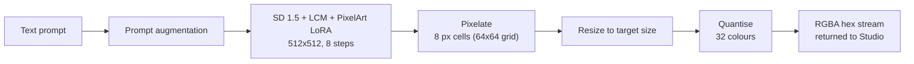

<!-- Banner: docs/banner.png (draw it in SpriteStack Studio, scale with nearest-neighbour) -->

# SpriteStack PixelGen

**Engineering and evaluation workspace for the text-to-pixel-art generator used in [SpriteStack Studio](https://github.com/Azjob21/spritestack).**

Goal: make prompt-to-sprite generation **cleaner** (real pixel grids, real transparency, palette control) and **faster** (GPU and CPU), with every change measured against a frozen baseline.

> **Status:** v0 baseline extracted from the Studio. Improvements are in progress; numbers marked `TBD` have not been measured yet.

---

## What this is (and is not)

v0 **composes existing open models**: it does not train a new one. The original work in this repo is the pipeline around them: prompt design, LCM fast sampling, LoRA fusing, pixel-grid post-processing, palette reduction, integration with the Studio API, and the measured improvements listed below.

| Component | Used in v0 | Source |
|---|---|---|
| Base model | Stable Diffusion 1.5, DreamShaper 8 LCM | `Lykon/dreamshaper-8-lcm` |
| Style LoRA | PixelArt Redmond (SD 1.5), fused at scale 0.9 | see its model card for author and licence |
| Scheduler | `LCMScheduler`, 8 steps, guidance 1.8 | diffusers |
| Post-processing | Nearest-neighbour pixelation, resize, 32-colour quantisation | this repo |

Model weights are **not** distributed here. Check each model's licence before redistributing anything.

---

## Pipeline (v0)



**Studio API contract** (`POST /generate-sprite`)

```json
// request
{ "prompt": "small slime enemy", "width": 32, "height": 32 }
// response
{ "hex": "RRGGBBAA...", "width": 32, "height": 32, "prompt": "...", "model": "..." }
```

---

## Known limitations of v0

Found while reviewing the current implementation. Each one is a roadmap item.

1. **No transparency.** Stable Diffusion outputs RGB, so alpha is always 255 and the generated background stays in the sprite.
2. **Grid decimation.** Pixelation assumes a 64×64 grid. For other target sizes the final nearest-neighbour resize skips cells instead of averaging them, and non-square targets are stretched from a square image.
3. **Fixed seed (42).** The same prompt always returns the same image; there is no way to re-roll.
4. **Classifier-free guidance is on** (guidance 1.8 with a negative prompt), which doubles the UNet work at every step.
5. **Blocking inference.** The pipeline call runs inside an async handler, so the API server's event loop is blocked while generating.
6. **Prompt issues.** The LoRA's trigger token (the filename suggests `PixArFK`) is not in the prompt, the style tokens mix "16-bit" and "8-bit", and "no anti-aliasing" is written in the positive prompt.
7. **Cold start.** The model loads lazily, so the first request pays the full load time.
8. **Generic palette.** Quantisation uses a generic 32-colour reduction instead of the Studio's palette presets (DB32, PICO-8, Endesga 32).

---

## Roadmap

**Phase 0: Baseline**
- [ ] Extract the generator into a standalone package (`src/pixelgen/`)
- [ ] Fixed evaluation set: ~30 prompts × fixed seeds
- [ ] Record latency (p50/p95) and peak memory on named hardware
- [ ] Save v0 sample grids to `eval/v0/`

**Phase 1: Quality**
- [ ] Trigger word (`PixArFK`) and prompt cleanup
- [ ] Proper grid snapping (dominant colour per cell, then resample to target)
- [ ] Palette-constrained quantisation (DB32, PICO-8, Endesga 32)
- [ ] Background removal producing hard 0/255 alpha
- [ ] Stray-pixel cleanup
- [ ] Seed control and multiple candidates per prompt

**Phase 2: Speed**
- [ ] Step count sweep (8, 6, 4)
- [ ] Guidance 1.0 (CFG off) vs 1.8
- [ ] Generation resolution sweep (512, 448, 384)
- [ ] Tiny VAE decode (TAESD)
- [ ] fp16 weights, `channels_last`, `torch.compile`
- [ ] CPU path (OpenVINO / ONNX / int8)
- [ ] Warm-up at startup and non-blocking inference

**Phase 3: Model**
- [ ] LoRA scale sweep
- [ ] Alternative LoRAs and accelerators (LCM-LoRA, Hyper-SD)
- [ ] Train a custom pixel-art LoRA on a curated, licensed dataset

**Phase 4: Release**
- [ ] Weights on Hugging Face Hub (where licences allow)
- [ ] Hugging Face Space demo
- [ ] Link from the Studio README

---

## Evaluation

There is no standard metric for pixel-art quality, so I combine several:

| Metric | What it measures |
|---|---|
| Latency p50 / p95, peak memory | Speed and memory |
| Unique colour count | Palette discipline |
| Grid cleanliness | Fraction of cells that are uniform after grid detection |
| Transparency success rate | Share of outputs with a clean background cut |
| CLIP score | Prompt alignment |
| Blind A/B preference | Human judgement on the fixed prompt set |

### Results

| ID | Change | CPU latency (i7-1065G7) | Quality notes |
|---|---|---|---|
| v0 | Baseline (fp32, 8 steps, guidance 1.8) | TBD | Reported in Studio docs: 30–60 s CPU |
| e1 | Trigger word + prompt cleanup | TBD | TBD |
| e2 | Guidance 1.0, no negative prompt | TBD | TBD |
| e3 | 4 steps | TBD | TBD |
| e4 | Grid snapping + palette presets | TBD | TBD |
| e5 | Background removal | TBD | TBD |
| e6 | OpenVINO / ONNX export | TBD | TBD |

Hardware: Intel Core i7-1065G7, 4C/8T @ 1.30 GHz, Intel Iris Plus Graphics, CPU-only inference.

---

## Quick start

```bash
pip install -e ".[dev]"
```

Place the base model under `models/pixel-art-model/` and the LoRA file under `models/loras/`.

```bash
# Generate a single sprite (CLI)
python -m pixelgen.cli generate "small slime enemy" --size 32x32 --out slime.png

# Run the v0 benchmark
python -m pixelgen.cli benchmark --prompts benchmarks/prompts.txt --out eval/v0/

# Start the API server (Studio-compatible)
python -m pixelgen.server --port 8000
```

---

## Repo layout

```
spritestack-pixelgen/
├── src/pixelgen/           # pipeline, postprocess, palettes, cli, server
│   ├── __init__.py
│   ├── pipeline.py         # v0 diffusion pipeline (extracted from Studio)
│   ├── postprocess.py      # pixelation, resize, quantisation
│   ├── palettes.py         # DB32, PICO-8, Endesga 32 palette data
│   ├── encode.py           # RGBA → hex encoding
│   ├── cli.py              # CLI entry point
│   └── server.py           # FastAPI server (Studio-compatible API)
├── benchmarks/             # prompt set, benchmark scripts
│   └── prompts.txt
├── eval/                   # sample grids and metrics per experiment
├── docs/                   # architecture notes, experiment log
├── examples/
├── tests/
│   └── test_postprocess.py
├── pyproject.toml
├── .gitignore
└── README.md
```

---

## Credits

- Base model: DreamShaper 8 LCM (see its model card)
- Style LoRA: PixelArt Redmond for SD 1.5 (see its model card)
- Libraries: Hugging Face `diffusers`, PyTorch, Pillow
- Part of the SpriteStack Studio project (course module supervised by Prof. Chaib Souleyman)

## License

Code: MIT. Model weights keep their original licences.
